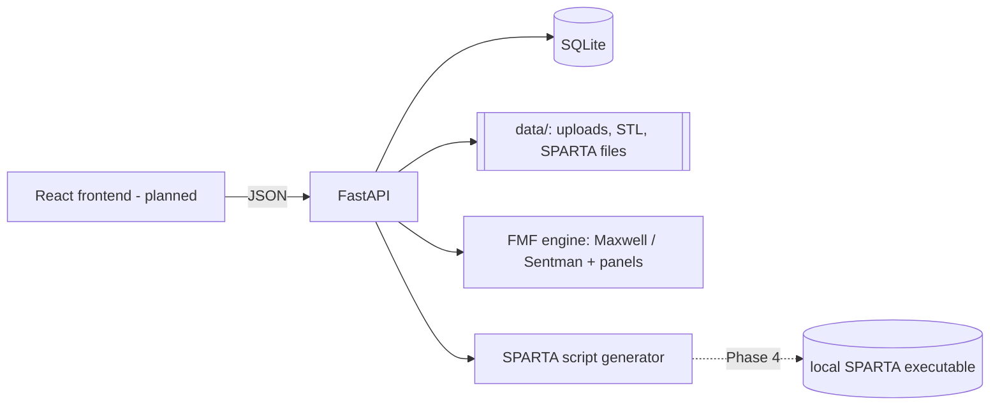

# AEROSIM

Free, open-source rarefied-aerodynamics workbench for **CubeSat and conical drag-sail deorbit studies**: free-molecular flow (FMF) calculations, DSMC configuration for [SPARTA](https://sparta.github.io/), atmospheric dataset management and (planned) FMF-vs-DSMC comparison. No paid APIs; runs locally on SQLite.

 <!-- replace OWNER/REPO -->

## Status

| Phase | Scope | Version | State |
|---|---|---|---|
| 1 | Atmospheric data manager (upload, column mapping, validation, versions) | 0.1.0 | done |
| 2 | Geometry + FMF engine (Maxwell, Sentman, panel method) | 0.2.0 | done |
| 3 | DSMC parameter manager + SPARTA input generation | 0.3.0 | done (backend) |
| 4 | Local SPARTA runner, output import | - | planned |
| 5 | FMF vs DSMC comparison, graphs, reports | - | planned |

The React frontend is not built yet; use the interactive API docs at `/docs`. See [CHANGELOG.md](CHANGELOG.md).

## Architecture



## Quick start

```bash
cd backend
pip install -r requirements.txt
uvicorn app.main:app --reload     # http://localhost:8000/docs
pytest
```

## Typical workflow

1. `POST /api/atmosphere/inspect` then `/api/atmosphere/datasets`: upload an NRLMSISE-00 CSV/TXT and confirm the column mapping.
2. `POST /api/geometry`: define the CubeSat body and conical sail.
3. `POST /api/fmf/run`: Cd, Cl, forces and moments versus altitude and attitude.
4. `POST /api/dsmc/defaults`, then `/api/dsmc/configurations`, then `/configurations/{id}/generate`: SPARTA input files in `backend/data/sparta/`.

## Scientific notes

- FMF models follow Schaaf and Chambre / Sentman; frame conventions and limitations are in each stored result.
- Generated SPARTA scripts are **not executed or verified** by AEROSIM yet. Nothing is reported as a simulation result until a real SPARTA run is imported (Phase 4).
- Approximate collision diameters for O, N and H are flagged in the code; review them before publishing results.

## Releasing

Bump `backend/app/__init__.py`, add a `CHANGELOG.md` entry, tag the release. CI fails if the current version has no changelog entry.

## License

MIT, see [LICENSE](LICENSE).
